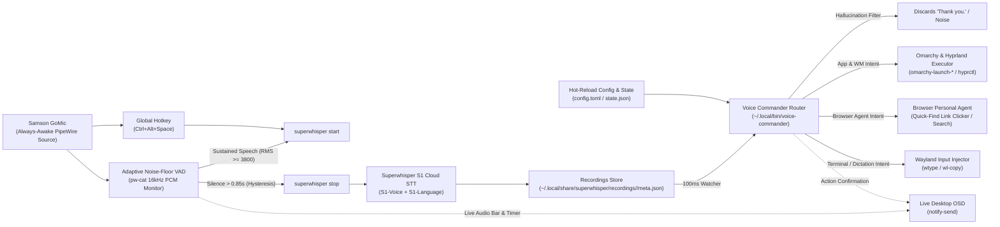

# Voice Commander (`voice-commander`)

**Voice-Controlled Desktop Assistant, Intent Router, and Browser Personal Agent for Omarchy Linux (Hyprland + Superwhisper + PipeWire).**

`voice-commander` turns your Linux desktop into a 100% voice-interactive environment from the moment your computer boots. Designed for **Omarchy Linux** (Hyprland on Wayland) with **Superwhisper** and a USB condenser microphone (such as the **Samson GoMic**), it bridges raw Speech-to-Text (STT) and full desktop automation—allowing you to launch applications, manage windows and workspaces, navigate websites, click links on pages, execute smart terminal commands, and dictate text seamlessly.

---

## System Architecture


> **Interactive Diagram**: Clone the repo and open [`docs/architecture.html`](docs/architecture.html) in any browser for the full interactive **Archify** diagram (pan/zoom, dark/light themes, node semantic passports, animated signal paths, and PNG/SVG/WebM export).



---

## Key Capabilities & Engineering Highlights

### 1. Adaptive Noise-Floor VAD with Hysteresis & Fast `0.85s` Auto-Stop
- **Always-Awake Microphone**: Enables Superwhisper's `keepMicrophoneReady` WirePlumber hook on startup so your first spoken syllable is never clipped.
- **Rolling Ambient Noise Floor**: Continuously computes the median RMS energy of quiet 100ms chunks (`~900–1300 RMS` on a sensitive condenser mic like the Samson GoMic) and dynamically adjusts start/stop thresholds.
- **Keyboard-Click & Noise Immunity**: Requires sustained voice activity (`300ms+` at `RMS >= 3800`) to start recording, preventing 50ms mechanical keyboard clicks from triggering false recordings while typing.
- **Instant Turnaround (`0.85s`)**: Uses stop hysteresis so background room hum never holds the recording open; automatically triggers `superwhisper stop` **0.85 seconds** after you finish speaking.
- **Whisper Silence-Hallucination Filter**: Automatically filters out known Whisper/S1 silence and keyboard-click hallucinations (`"Thank you."`, `"You're welcome."`, `"Thanks for watching."`) before they can pollute your terminal or editor.

### 2. Live Runtime OSD Feedback
- While you speak, an on-screen notification displays a real-time audio level meter and countdown:
  `Listening... (1.8s) | Mic: [██████░░░░] | Pause 0.8s to send`
- Immediately transitions to `"Processing Speech..."` when you pause, followed by an action confirmation alert (`[Launching App] Chromium`, `[Keyboard Action] Pressed Enter`, etc.).

### 3. Multi-Command Splitter & Conversational Intent Router
- **Ordered Compound Execution**: Splits multi-sentence utterances on wake words (`Computer`, `Assistant`, `Jarvis`, `Omarchy`, `Command`, `System`, `Agent`) and sentence boundaries, executing mixed dictation and commands in exact sequence:
  - Example: *"I want you to put this on GitHub as a public repository. Enter. Stop listening."*
    1. Types `"I want you to put this on GitHub as a public repository. "` into the active CLI/chat window
    2. Presses `Enter` (`Return`)
    3. Pauses hands-free VAD listening
- **Conversational Wrapper Stripping**: Automatically strips polite phrasing (*"Can you please..."*, *"Could you..."*, *"I want you to..."*, *"...please"*, *"...right now"*) and deduplicates repeated retries in the same clip.
- **Zero Command Leakage**: Any phrase prefixed with a wake word (*"Computer, ..."*) is guaranteed to never be pasted as raw text into an active input field.

### 4. Agentic Browser Personal Assistant
- **Voice Link Clicking**: Say *"Computer, click on link <text>"* (or *"open link <text>"*) on any open webpage in Chromium/Firefox. The agent triggers browser Quick-Find (`Ctrl+F` → types `<text>` → `Enter` → `Escape` → `Enter`) to focus the matching link or button and activate it hands-free.
- **Topic & Site Navigation**: Say *"Computer, take me to Hacker News"* (opens configured site), *"Computer, take me to github dot com"* (opens domain), or *"Computer, take me to <any topic>"* (launches a web search for that topic).
- **Direct Platform Search & Tab Control**: Search YouTube or GitHub directly by voice, highlight terms on the current page, cycle matches, navigate back/forward, and jump to tabs `1–9`.

### 5. Three Stateful Operating Modes
Switch modes at any time by voice or CLI (`voice-commander mode <hybrid|command|dictation>`):
- **Hybrid Mode (`hybrid`, Default)**: Commands and wake-prefixed phrases execute desktop/browser/terminal actions; natural conversational sentences are typed into the focused window.
- **Command Mode (`command`)**: Strictly executes commands only—unrecognized speech is never typed unless explicitly prefixed with *"Type <text>"*.
- **Dictation Mode (`dictation`)**: Everything you say is typed directly into the active window unless prefixed with a wake word (*"Computer, ..."*) or *"Command mode"*.

---

## Complete Voice Command Reference

### 1. Application Launching
*(Prefix with `"Computer, ..."` or speak directly in Hybrid/Command mode)*

| Voice Command | Action Executed |
| :--- | :--- |
| **"Open terminal"** / **"Open console"** / **"Open shell"** | Launches Omarchy terminal (`omarchy-launch-terminal`) |
| **"Open tmux"** / **"Open herdr"** | Launches terminal with `tmux` or `herdr` |
| **"Open browser"** / **"Open Chromium"** / **"Open Chrome"** | Launches default web browser (`omarchy-launch-browser`) |
| **"Open files"** / **"Open file manager"** / **"Open Nautilus"** | Opens Nautilus file manager |
| **"Open editor"** / **"Open code"** / **"Open Neovim"** | Launches configured text editor (`omarchy-launch-editor`) |
| **"Open system monitor"** / **"Open monitor"** / **"Open btop"** | Opens `btop` system resource monitor |
| **"Open music"** / **"Open Audacious"** / **"Open Spotify"** | Launches music player |
| **"Open Discord"** / **"Open Signal"** / **"Open Docker"** | Launches respective app or TUI |
| **"Open settings"** / **"Open Superwhisper"** | Opens Superwhisper settings window |
| **"See apps"** / **"Show apps"** / **"App launcher"** | Opens the Omarchy application launcher (`Super` key) |

### 2. Browser Personal Assistant & Web Navigation
| Voice Command | Action Executed |
| :--- | :--- |
| **"Take me to Hacker News"** *(or Google, YouTube, GitHub, ChatGPT, Gmail, Reddit, X, LinkedIn, Wikipedia)* | Opens the website directly in the browser |
| **"Take me to `<domain.com>`"** / **"Go to `github dot com`"** | Navigates directly to `https://<domain>` |
| **"Take me to `<any topic>`"** / **"Search for `<query>`"** | Opens browser and searches Google for `<query>` |
| **"Search YouTube for `<query>`"** | Searches YouTube directly for `<query>` |
| **"Search GitHub for `<query>`"** | Searches GitHub repositories/code for `<query>` |
| **"Click on link `<text>`"** / **"Open link `<text>`"** / **"Follow link `<text>`"** | Finds `<text>` on the active webpage and clicks the link (`Ctrl+F` → `<text>` → `Enter` → `Escape` → `Enter`) |
| **"Find on page `<text>`"** / **"Search page for `<text>`"** | Highlights `<text>` on the current webpage |
| **"Next match"** / **"Previous match"** | Jumps to next/previous search match (`Ctrl+G` / `Ctrl+Shift+G`) |
| **"New tab"** / **"Close tab"** / **"Reopen tab"** | `Ctrl+T` / `Ctrl+W` / `Ctrl+Shift+T` |
| **"Next tab"** / **"Previous tab"** | Cycles browser/terminal tabs (`Ctrl+Tab` / `Ctrl+Shift+Tab`) |
| **"Tab two"** / **"Switch to tab 1–9"** | Jumps directly to browser tab `1–9` (`Ctrl+1`..`Ctrl+9`) |
| **"Go back"** / **"Go forward"** | Browser history back (`Alt+Left`) / forward (`Alt+Right`) |
| **"Refresh page"** / **"Address bar"** | Reloads page (`Ctrl+R`) or focuses URL bar (`Ctrl+L`) |

### 3. Typing, Dictation & Keyboard Shortcuts
| Voice Command | Action Executed |
| :--- | :--- |
| **`"<Any natural sentence>"`** *(in Hybrid or Dictation mode)* | Types the sentence directly into the focused window via `wtype` |
| **`"<Any sentence> press enter"`** *(or **`"<sentence>. Enter."`**)* | Types the sentence and immediately presses `Enter` |
| **"Type `<text>`"** / **"Write `<text>`"** / **"Dictate `<text>`"** | Types `<text>` (works in all modes, including strict Command Mode) |
| **"Type `<text>` and press enter"** / **"Type line `<text>`"** | Types `<text>` and presses `Enter` |
| **"Enter"** / **"Press enter"** / **"Hit enter"** / **"Submit"** / **"Send"** / **"Send it"** | Presses `Return` (`Enter`) in the active CLI, terminal, or chat box |
| **"Shift enter"** | Presses `Shift+Return` (new line without submitting in chat interfaces) |
| **"Escape"** / **"Press escape"** | Presses `Escape` |
| **"Tab"** / **"Press tab"** / **"Press space"** | Presses `Tab` or `Space` |
| **"Backspace"** / **"Scratch that"** / **"Delete word"** | Deletes last character (`BackSpace`) or last word (`Ctrl+BackSpace`) |
| **"Clear input"** | Clears current CLI/input line (`Ctrl+U`) |
| **"Copy"** / **"Paste"** / **"Cut"** / **"Select all"** | `Ctrl+C` / `Ctrl+V` / `Ctrl+X` / `Ctrl+A` |
| **"Undo"** / **"Redo"** / **"Save"** | `Ctrl+Z` / `Ctrl+Y` / `Ctrl+S` |
| **"Scroll down"** / **"Scroll up"** / **"Go to top"** / **"Go to bottom"** | `PageDown` / `PageUp` / `Home` / `End` |
| **"Press control C"** / **"Stop process"** | Sends `Ctrl+C` to interrupt a running terminal process |
| **"Press control D"** / **"Press control L"** / **"Press control Z"** | Sends `Ctrl+D`, `Ctrl+L`, or `Ctrl+Z` |

### 4. Smart Terminal Commands
| Voice Command | Shell Command Typed & Executed |
| :--- | :--- |
| **"Run `<any shell command>`"** *(e.g. `"Run git status"`, `"Run ls dash la"`)* | Converts spoken flags (`dash` → `-`, `slash` → `/`, `dot` → `.`, `pipe` → `\|`), types command, and presses `Enter` |
| **"List files"** | `ls -la` |
| **"Git status"** / **"Status"** | `git status` |
| **"Git diff"** / **"Git log"** / **"Git pull"** | `git diff` / `git log --oneline -n 10` / `git pull` |
| **"Clear terminal"** / **"Clear screen"** | `clear` |
| **"Current directory"** | `pwd` |
| **"Go home"** / **"Go back"** / **"Go up"** | `cd ~` / `cd ..` |
| **"Go to downloads"** / **"Go to documents"** / **"Go to desktop"** | `cd ~/Downloads && ls -la` (etc.) |
| **"Disk usage"** / **"Memory usage"** / **"Processes"** | `df -h` / `free -h` / `ps aux \| head -n 20` |
| **"Update system"** | `omarchy update` |

### 5. Hyprland Window, Workspace & System Control
| Voice Command | Action Executed |
| :--- | :--- |
| **"Workspace two"** / **"Switch to workspace 1–10"** | Switches Hyprland to Workspace `1–10` |
| **"Move to workspace two"** / **"Move window to workspace 1–10"** | Moves active window to Workspace `1–10` |
| **"Next workspace"** / **"Previous workspace"** | Cycles active monitor workspaces (`m+1` / `m-1`) |
| **"Focus left"** / **"Focus right"** / **"Focus up"** / **"Focus down"** | Moves Hyprland window focus (`hyprctl dispatch movefocus`) |
| **"Fullscreen"** / **"Maximize"** / **"Expand window"** | Toggles fullscreen (`hyprctl dispatch fullscreen 0`) |
| **"Toggle floating"** / **"Float window"** / **"Tile window"** | Toggles floating mode (`hyprctl dispatch togglefloating`) |
| **"Close window"** / **"Quit window"** / **"Close app"** | Closes active window (`hyprctl dispatch killactive`) |
| **"Volume up"** / **"Volume down"** / **"Mute"** | Adjusts PipeWire default sink volume (`+10%`, `-10%`, mute toggle) |
| **"Brightness up"** / **"Brightness down"** | Adjusts screen backlight (`+15%`, `-15%` via `brightnessctl`) |
| **"Take screenshot"** / **"Screenshot"** | Launches `omarchy-capture-screenshot` |
| **"Toggle night light"** | Toggles `hyprsunset` blue-light filter (`omarchy toggle nightlight`) |
| **"Lock screen"** | Locks session (`omarchy-system-lock`) |

### 6. Hands-Free & Mode Control
| Voice Command | CLI Equivalent | Effect |
| :--- | :--- | :--- |
| **"Start listening"** / **"Hands-free on"** | `voice-commander hands-free on` | Enables continuous Adaptive VAD listening on the microphone |
| **"Stop listening"** / **"Pause listening"** / **"Don't listen"** | `voice-commander hands-free off` | Pauses continuous listening (use `Ctrl+Alt+Space` hotkey to talk) |
| **"Hybrid mode"** / **"Smart mode"** | `voice-commander mode hybrid` | Commands execute actions; natural sentences are typed as text |
| **"Command mode"** / **"Stop dictation"** | `voice-commander mode command` | Only executes commands; ignores non-command speech |
| **"Dictation mode"** / **"Start dictation"** | `voice-commander mode dictation` | Types everything unless prefixed with `"Computer, ..."` |

---

## Repository Structure

```text
voice-commander/
├── bin/
│   └── voice-commander                 # Main Python 3 daemon, Adaptive VAD, Intent Router & CLI
├── config/
│   └── config.toml                     # Hot-reloaded configuration (wake words, VAD, apps, sites, shell shortcuts)
├── systemd/
│   └── voice-commander.service         # systemd --user service unit for boot startup
├── docs/
│   ├── architecture.svg                # Vector architecture diagram (rendered by Archify)
│   ├── architecture.html               # Standalone interactive HTML architecture viewer (Archify)
│   └── architecture.archify.json       # Archify architecture specification
└── README.md                           # Project documentation
```

---

## Installation & Setup

### Prerequisites
- **OS / WM**: Arch Linux / [Omarchy](https://omarchy.org/) with **Hyprland** (Wayland)
- **Speech-to-Text**: `superwhisper` (`superwhisper.service`)
- **Packages**: `python3` (>= 3.11), `pipewire` (`pw-cat`), `wireplumber` (`wpctl`), `wtype`, `wl-clipboard`, `libnotify` (`notify-send`), `brightnessctl`

### Install Files & Enable Startup Service

```bash
# 1. Install binary and configuration
install -Dm755 bin/voice-commander ~/.local/bin/voice-commander
install -Dm644 config/config.toml ~/.config/voice-commander/config.toml
install -Dm644 systemd/voice-commander.service ~/.config/systemd/user/voice-commander.service

# 2. Configure Superwhisper so Voice Commander manages routing & microphone readiness
superwhisper general set autoPasteEnabled false
superwhisper general set launchAtLogin true
superwhisper audio set keepMicrophoneReady true

# 3. Enable and start the systemd user service
systemctl --user daemon-reload
systemctl --user enable --now voice-commander.service
```

### CLI Usage & Testing

```bash
# Check daemon mode and VAD status
voice-commander status

# Test how any voice phrase is routed without executing side effects (--dry-run)
voice-commander exec --dry-run "Computer, open Chromium"
voice-commander exec --dry-run "I want you to put this on GitHub as a public repository. Enter. Stop listening."

# Execute a voice command directly from the terminal
voice-commander exec "Computer, take me to Hacker News"

# Switch operating modes or toggle hands-free VAD
voice-commander mode hybrid
voice-commander hands-free toggle

# Tail live VAD and command logs
journalctl --user -u voice-commander -f
```

---

## License

Apache-2.0
